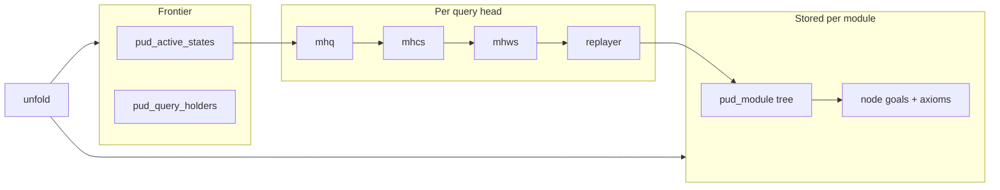
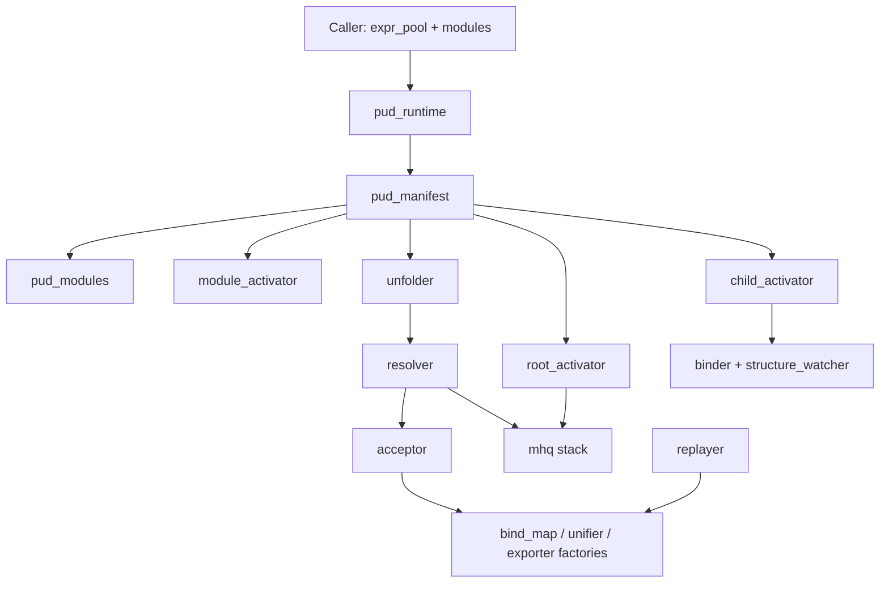
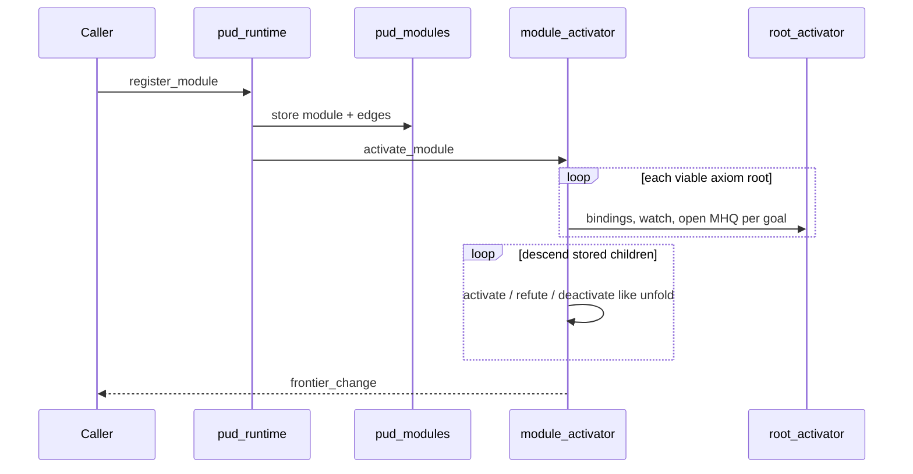
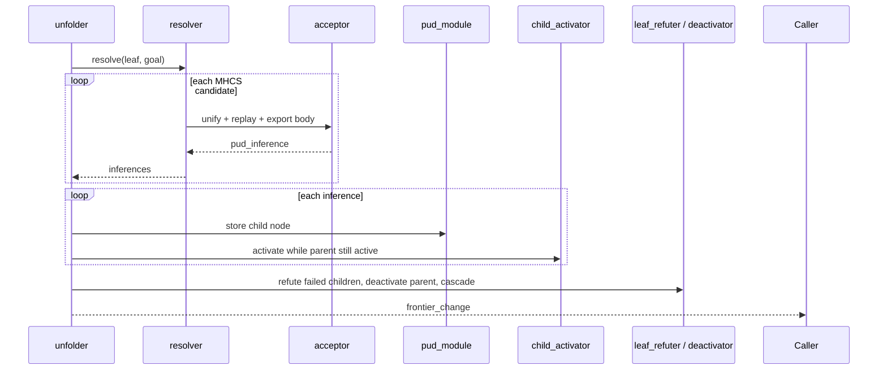
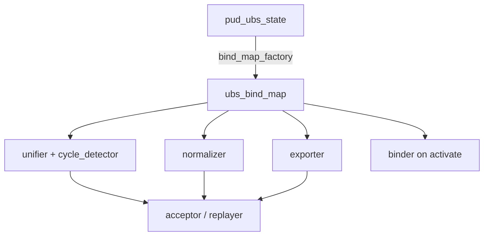

# PUD architecture

Progressive unfolding database (PUD): each registered **module** is an append-only resolution tree (axioms, then stored inferences). A **frontier** of **active leaves** sits on top: bindings, structure watches, and open **multi-headed queries** (MHQ). The caller expands by `unfold(leaf, body_goal)`; the runtime picks candidates, materializes child nodes, moves activity to children, and retires the parent.

Deeper query semantics: [pud-query-model.txt](pud-query-model.txt). Design history: [pud-smell-resolution.md](pud-smell-resolution.md).

---

## Two planes of state

PUD keeps **stored structure** separate from **what is live on the frontier**. Search machinery walks the stored tree but does not duplicate it as a second query tree.



**Stored:** `pud_modules` registers `pud_module` instances. Each node has body goals (`pud_node_goals`), optional axiom head (`pud_node_axioms`), and inferences appended when unfold succeeds. Nodes are never deleted; refutation is a flag on the tree.

**Live:** Only leaves (and the transient parent during an unfold step) have `pud_active_state`: a binding snapshot (`pud_ubs_state`), a structure watch, and a map from `pud_body_goal_id` to an MHQ head. `pud_query_holders` records which leaves hold which heads so admitting or refuting a query can find every dependent leaf.

**Search:** For one body goal’s query head, `pud_mhq` coordinates heads; `pud_mhcs` chooses among axiom-level candidates; `pud_mhws` DFS-es witness paths along one edge; `pud_replayer` walks the stored inference chain inside a single `ubs_bind_map`, unifying substitutions. Resolver/acceptor use the same stack when materializing a chosen candidate into a `pud_inference`.

---

## Composition and entry

Callers own `expr_pool` and module payloads. `pud_runtime` is a thin facade; `pud_manifest` is the composition root that wires every `pud_*` collaborator via template injection.



**Registration path:** `register_module` → `pud_modules` stores the tree → `pud_module_activator` activates axiom roots (`pud_root_activator`) and walks interior nodes like a batch of mini-unfolds (child activation, refute dead ends, deactivate parents). Result: `pud_frontier_change` (new active leaves).

**Unfold path:** `unfolder` calls `resolver` for the leaf’s goal, stores each `pud_inference` on the module, activates every child while the parent still holds queries (`pud_child_activator`), refutes children that cannot get candidates, deactivates the parent (`pud_node_deactivator`), and refutes leaves stranded without candidates (`pud_leaf_refuter` + `pud_refutation_propagator`). Same frontier-change shape as register.

Public handles are `pud_global_node_id` (module + local `pud_node_id`) and `pud_body_goal_id` (stable slot on a node’s goal list—not an expression pointer).

---

## Register module (sequence)



---

## Unfold one goal (sequence)



The resolver reads the leaf’s active state and goal expression, iterates candidates from the goal’s MHQ head, and delegates each to **acceptor**: build bind map from caller bindings, unify call site with candidate head, replay the witness path, export callee body goals into the caller frame, and produce substitutions for the child binder. **Child activator** merges parent `pud_ubs_state` with those substitutions, installs structure watch, inherits/forks/opens queries, and registers holds.

---

## Term environment (one bind map per step)

Unification, normalization, export, and binding all share the same pattern: `pud_ubs_state` → `make_bind_map` → `ubs_bind_map`, then framed terms (`framed_expr` / `framed_functor`) with `globalizer` turning frame-local indices into class keys.



Small **factories** (`pud_bind_map_factory`, `pud_cycle_detector_factory`, `pud_unifier_factory`, `pud_normalizer_factory`, `pud_exporter_factory`) each expose one `make_*` so tests can mock a single capability. Accept/replay paths edit the map and record which caller classes were unbound when touched; exporter rebuilds goal expressions in the caller’s LVC with a translation map for fresh variables.

`pud_structure_watcher` (with `expr_pool` for functor shape) tracks which body goals changed under the child substitution so MHQ can fork or reopen heads without rescanning the whole goal list blindly.

---

## Where code lives

Infrastructure behavior is header-first under `core/hpp/infrastructure/pud_*.hpp` (plus `pud_bind_map_factory.cpp`). Shared shapes and ids live in `core/hpp/value_objects/pud_*.hpp`. `pud_manifest.hpp` is the map of how types connect; start there, then follow the unfold chain (`unfolder` → `resolver` → `acceptor`) or the activation chain (`root_activator` / `child_activator` → `binder`, `structure_watcher`, `mhq`). Integration coverage is `core/test/integration/pud_*.cpp`; unit tests mock collaborators in `core/test/unit/infrastructure/pud_*.cpp`. `pud_term_stack.hpp` bundles real term factories for tests.

---

## Mental model (ASCII)

```text
  STORED TREE                    FRONTIER                         SEARCH
  axioms + inferences     →      bindings + watch + MHQ     →     MHQ → MHCS → MHWS → replayer
  (immutable append)             (transient per leaf)              (finds axiom paths in tree)
```

Replay state and query heads attach to the **same** nodes as the resolvent tree; there is no parallel query DAG. Deprecated ideas are listed at the end of [pud-query-model.txt](pud-query-model.txt).
